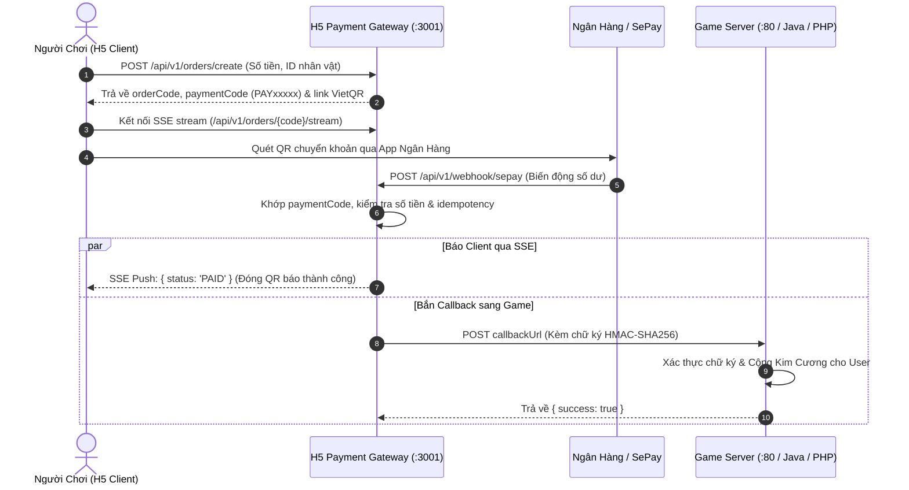

# ⚡ H5 Game Payment Gateway (SePay & VietQR Core API Component)

> Bộ API Component độc lập chuyên xử lý **tự động hóa thanh toán nạp tiền**, sinh **VietQR động** và lắng nghe **Webhook SePay / Ngân hàng** cho các dòng Game H5.
> Kiến trúc module hóa 100%, không phụ thuộc tên riêng bất kỳ dự án nào, sẵn sàng tích hợp ngay vào bất kỳ Game H5 nào (PHP, Node.js, Python, Java).

---

## 🌟 Tính Năng Nổi Bật

- 🚀 **Tự động 100% (Zero-Touch):** Người chơi quét VietQR chuyển khoản $\rightarrow$ Webhook nhận diện giao dịch trong 1-3 giây $\rightarrow$ Game Server tự động cộng tiền/kim cương ngay lập tức.
- 💳 **Tích hợp SePay & VietQR:** Tự động sinh link ảnh QR động SePay (`qr.sepay.vn`) kèm fallback trực tiếp từ VietQR (`api.vietqr.io`).
- ⚡ **Realtime Server-Sent Events (SSE):** Giao diện nạp trên Client tự động nhận tín hiệu thành công tức thì và đóng popup mà không cần gửi request polling liên tục.
- 🛡️ **Bảo Mật HMAC-SHA256:** Callback gửi sang Game Server được ký mã hóa HMAC-SHA256 chống giả mạo gói nạp hoặc gian lận can thiệp API.
- 🔒 **Chống Nạp Trùng (Idempotency Guard):** Cơ chế lọc giao dịch kép ngăn chặn tuyệt đối tình trạng nhận trùng webhook gây cộng kim cương 2 lần.
- 🔄 **Cơ Chế Retry Thông Minh:** Tự động thử lại (Exponential Backoff) nếu Game Server tạm thời bận hoặc nghẽn mạng.
- 🗄️ **Lưu Trữ Linh Hoạt (Dual Storage):** Hỗ trợ `FileStore` (JSON data) chạy ngay lập tức không cần cài đặt DB, và `MySQLStore` cho môi trường production tải cao.
- 🧰 **Đầy Đủ Bộ SDK & Widget:** Cung cấp sẵn SDK PHP, Node.js, Python và Widget JS nhúng 1 dòng code vào giao diện Client Game H5.
- 🧪 **Interactive Sandbox & Test Playground:** Trang quản trị trực quan tại `http://localhost:3001` cho phép tạo đơn, xem QR, và mô phỏng webhook nạp tiền chỉ bằng 1 cú click chuột.

---

## 🏗️ Luồng Hoạt Động (Architecture Flow)



---

## 🚀 Cài Đặt & Khởi Động Nhanh

### 1. Yêu Cầu Môi Trường
- Node.js >= 16.x (Khuyên dùng v18+ hoặc v20+)
- npm hoặc yarn

### 2. Cài Đặt Thư Viện
```bash
git clone https://github.com/vibekid2026/h5-game-payment-gateway.git
cd h5-game-payment-gateway
npm install
```

### 3. Cấu Hình `.env`
Sao chép cấu hình mẫu và chỉnh sửa thông tin tài khoản ngân hàng:
```bash
cp .env.example .env
```

Các biến môi trường quan trọng:
```ini
PORT=3001
GATEWAY_SECRET_KEY=your_secret_key_here

# Tài khoản nhận tiền ngân hàng
BANK_CODE=MBBank
BANK_ACCOUNT_NUMBER=0987654321
BANK_ACCOUNT_NAME=NGUYEN VAN A
SEPAY_API_KEY=your_sepay_api_key

# Tiền tố mã chuyển khoản (PAY123456)
PAYMENT_CODE_PREFIX=PAY
```

### 4. Khởi Chạy Server
```bash
# Khởi động Gateway
npm start

# Hoặc chế độ phát triển (Auto reload)
npm run dev
```

Truy cập Test Playground tại: **`http://localhost:3001`**

---

## 📡 Tài Liệu API (API Reference)

### 1. Tạo Đơn Nạp Game
- **Endpoint:** `POST /api/v1/orders/create`
- **Request Body:**
```json
{
  "amount": 50000,
  "userId": "10000000034",
  "serverId": "S1",
  "gameCode": "MY_H5_GAME",
  "itemPackage": "PKG_DIAMOND_50K",
  "notifyUrl": "http://127.0.0.1:80/api/payment_callback.php",
  "customExtra": { "roleName": "Raykipaxe" }
}
```
- **Response Success (200):**
```json
{
  "success": true,
  "data": {
    "orderCode": "ORD_17400000_A1B2",
    "paymentCode": "PAY849201",
    "amount": 50000,
    "qrCodeUrl": "https://qr.sepay.vn/img?bank=MBBank&acc=0987654321&template=compact&amount=50000&des=PAY849201",
    "status": "PENDING",
    "expiresAt": "2026-11-21T07:35:00.000Z"
  }
}
```

---

### 2. Tra Cứu Trạng Thái Đơn Hàng
- **Endpoint:** `GET /api/v1/orders/:orderCode`

---

### 3. Realtime Server-Sent Events (SSE)
- **Endpoint:** `GET /api/v1/orders/:orderCode/stream`
- **Mô tả:** Client lắng nghe luồng SSE. Khi đơn hàng được thanh toán, server sẽ push sự kiện:
```json
{
  "orderCode": "ORD_17400000_A1B2",
  "status": "PAID",
  "paidAt": "2026-11-21T07:22:15.000Z",
  "amount": 50000,
  "transactionRef": "MBVCB.12345678"
}
```

---

### 4. Webhook Nhận Biến Động Số Dư (SePay)
- **Endpoint:** `POST /api/v1/webhook/sepay`
- **Header:** `Authorization: Apikey <SEPAY_API_KEY>`
- **Payload SePay tiêu chuẩn:**
```json
{
  "id": 92704,
  "gateway": "MBBank",
  "transactionDate": "2026-11-21 14:20:00",
  "accountNumber": "0987654321",
  "content": "PAY849201 nap game",
  "transferType": "in",
  "transferAmount": 50000,
  "referenceCode": "MBVCB.98765432"
}
```

---

### 5. Callback Gửi Sang Game Server (HMAC-SHA256)
Khi nhận tiền thành công, Gateway sẽ gửi HTTP POST tới `notifyUrl` của Game Server:
- **Headers:**
  - `Content-Type: application/json`
  - `X-Gateway-Signature: <hmac_sha256_hex>`
- **Payload:**
```json
{
  "orderCode": "ORD_17400000_A1B2",
  "paymentCode": "PAY849201",
  "gameCode": "MY_H5_GAME",
  "userId": "10000000034",
  "serverId": "S1",
  "amount": 50000,
  "itemPackage": "PKG_DIAMOND_50K",
  "customExtra": { "roleName": "Raykipaxe" },
  "paidAt": "2026-11-21T07:22:15.000Z",
  "transaction": {
    "gateway": "MBBank",
    "referenceCode": "MBVCB.98765432",
    "transferAmount": 50000
  },
  "timestamp": 1740000000000,
  "signature": "3f9a7c..."
}
```

---

## 🧩 Hướng Dẫn Tích Hợp Vào Game H5 (SDKs)

### 1. Nhúng Giao Diện Thanh Toán Vào Client H5 (1 dòng script)
```html
<script src="http://localhost:3001/widget.js"></script>
<script>
  // Mở popup quét mã QR khi người chơi bấm nút "Nạp Thẻ"
  H5Payment.open({
    gatewayUrl: 'http://localhost:3001',
    orderCode: order.orderCode,
    paymentCode: order.paymentCode,
    qrCodeUrl: order.qrCodeUrl,
    amount: 50000,
    onSuccess: function(data) {
      alert('Nạp tiền thành công! Kim cương đã được cộng vào tài khoản.');
      window.location.reload();
    }
  });
</script>
```

### 2. Tích Hợp Game Backend (PHP)
Xem file mẫu hoàn chỉnh tại: [`sdk/php/sample_callback_receiver.php`](sdk/php/sample_callback_receiver.php).

```php
require_once 'sdk/php/H5PaymentClient.php';

$client = new H5PaymentClient('http://localhost:3001', 'your_secret_key');

// 1. Tạo đơn nạp
$order = $client->createOrder([
    'amount' => 50000,
    'userId' => $playerId,
    'serverId' => 'S1',
    'itemPackage' => 'PKG_VIP',
    'notifyUrl' => 'http://my-game.com/api/payment_callback.php'
]);

// 2. Xác thực Webhook Callback
$isValid = $client->verifyCallback($callbackPayload, $_SERVER['HTTP_X_GATEWAY_SIGNATURE']);
if ($isValid) {
    // Cộng Kim Cương an toàn 100%
}
```

---

## 🧪 Kiểm Thử Toàn Trình (Automated Test Suite)

Dự án tích hợp bộ kiểm thử tự động 100% bao gồm cả luồng tạo đơn, bắt webhook, kiểm tra idempotency và chữ ký HMAC:

```bash
npm test
```

---

## 📄 License
Phát hành theo giấy phép **MIT License**. Tự do sử dụng và tích hợp cho mọi dự án Game H5 thương mại và cá nhân.
